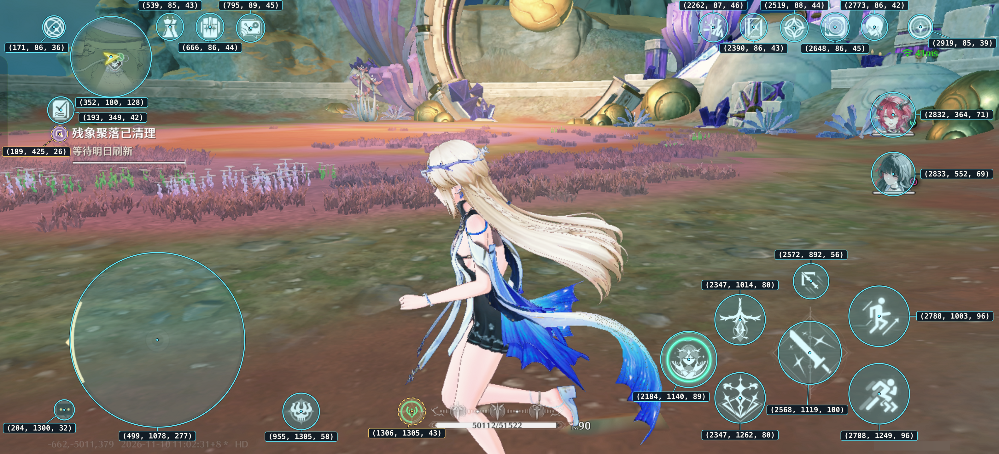
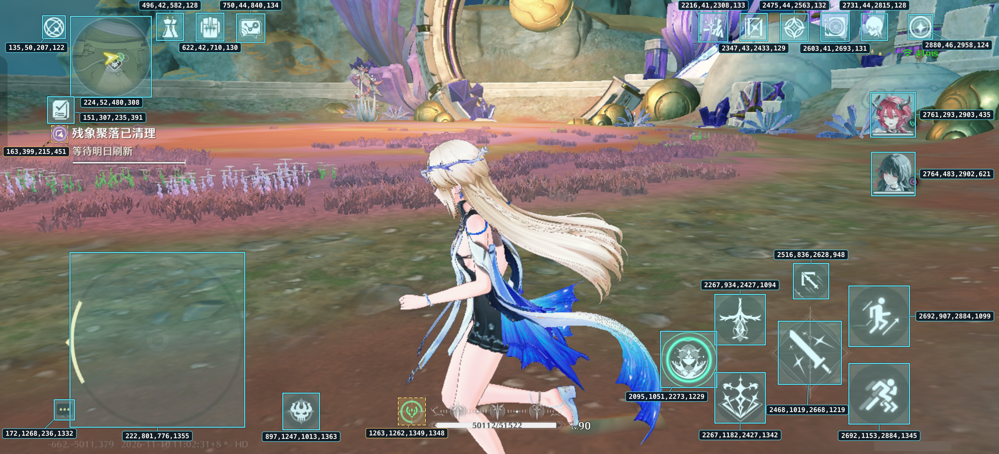

# coordinates

## circle

circle aread: used for tap

skill coordinates

| region   | x,y,radius    | description   |
| -------- | ------------- | ------------- |
| joystick | 499,1078,277  |               |
| lock     | 1306,1305,43  | Select Enemy  |
| c1       | 2832,364,71   | change role 1 |
| c2       | 2832,552,69   | change role 2 |
| A        | 2568,1119,100 |               |
| E        | 2347,1262,80  |               |
| S        | 2347,1014,80  | ShengHai      |
| R        | 2184,1140,89  |               |
| T        | 2572,892,56   | Tool          |
| J        | 2788,1003,96  | Jump          |
| V        | 2788,1249,96  | Avoid         |

## rect

rect areas: used for YOLO skill clickable check

| region | x,y,radius          | description |
| ------ | ------------------- | ----------- |
| A      | 2468,1019,2668,1219 |             |
| E      | 2267,1182,2427,1342 |             |
| S      | 2267,934,2427,1094  | ShengHai    |
| R      | 2095,1051,2273,1229 |             |
| T      | 2516,836,2628,948   | Tool        |
| J      | 2692,907,2884,1099  | Jump        |
| V      | 2692,1153,2884,1345 | Avoid       |
